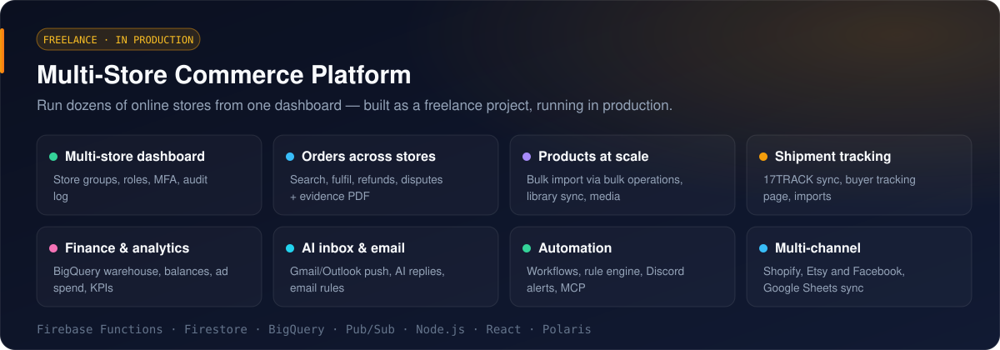
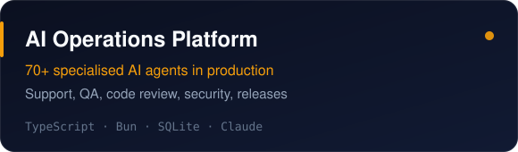
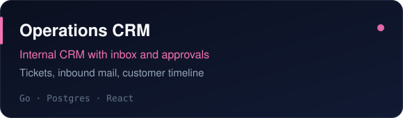
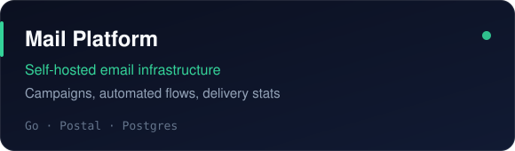

  

  
  
  
  
  

  

 

## Summary

Full-stack engineer and team leader with **5+ years in e-commerce**. My daily stack is **Node.js and Firebase** (Cloud Functions, Firestore, Pub/Sub, BigQuery) with **React** on the front end; before that I spent three years on Magento 2 (PHP). Outside my full-time role I build freelance services in **Go** and automate work with **AI agents**. I take products from design to production and lead teams through planning, code review and release.

 

## Experience

  

**Team Leader** — Avada Group · *Aug 2025 – Present*
- Lead a development team: break work into tasks, set technical direction and review every merge.
- Own architecture and delivery of commerce apps on **Node.js, Firebase (Functions, Firestore, Pub/Sub) and React**, from spec to production.
- Introduced AI-assisted workflows (agents for QA, code review and support) into the team's daily process.

**Shopify App Developer** — Avada Group (spun off from Mageplaza) · *Jul 2024 – Aug 2025*
- Built Shopify apps end to end with **Node.js, Firebase Functions, Firestore and React/Polaris**.
- Implemented OAuth, webhooks, billing and GDPR flows, and took apps through Shopify app review.
- Worked with Shopify Admin GraphQL/REST APIs, bulk operations and theme app extensions.

**Magento 2 Team Leader** — Mageplaza · *2023 – Jul 2024*
- Led the Magento team: task planning, estimates, code review and releases.
- Kept extension quality consistent across versions and customer customisations.

**Magento 2 Developer** — Mageplaza · *May 2021 – 2023*
- Joined as an intern and grew into a developer on the Magento 2 extension team.
- Built and maintained Magento 2 extensions and store customisations in **PHP, MySQL and JavaScript**.

 

## Freelance &amp; side projects

Built outside my full-time role at Avada Group.

  

**Multi-Store Commerce Platform** — freelance, in production · *Node.js, Firebase Functions, Firestore, BigQuery, Pub/Sub, React, Polaris*
- One dashboard to run many online stores: orders, products, tracking, finance and email in one place.
- Cross-store orders with fulfilment, refunds and disputes (evidence PDF); bulk product import via bulk operations.
- 17TRACK shipment sync with a public buyer tracking page; Google Sheets order sync.
- BigQuery finance warehouse; AI inbox on Gmail/Outlook push; workflows, rule engine, Discord alerts and an MCP server.
- Roles, store groups, MFA and audit logs; channels: Shopify, Etsy and Facebook.

<table>
  <tr>
    <td width="50%"></td>
    <td width="50%"></td>
  </tr>
  <tr>
    <td width="50%"></td>
    <td width="50%"></td>
  </tr>
  <tr>
    <td width="50%"></td>
    <td width="50%"></td>
  </tr>
</table>

- **AI Operations Platform** — 70+ specialised AI agents for support, QA, code review, security scans and releases, with human approval on key decisions. *TypeScript, Bun, SQLite, Claude.*
- **Desktop Agent Runtime** — cross-platform desktop app with a durable job queue, offline SQLite and an MCP client. *Rust, Tauri 2.*
- **Nhịp** — native mobile app (lunar calendar, spending, habits, trips) for iOS and Android with a Go API. *SwiftUI, Jetpack Compose, Go, Postgres.*
- **Operations CRM** (freelance) — tickets, inbound mail, customer timeline and approvals. *Go, Postgres, React.*
- **Account Portal** (freelance) — customer accounts with Google sign-in, TOTP 2FA and sessions. *Go, Postgres, React.*
- **Mail Platform** (freelance) — self-hosted email: campaigns, automated flows and delivery stats. *Go, Postal, Postgres.*

Source code is private. Happy to walk through the architecture on a call.

 

## Skills

  

**Languages** — JavaScript (Node.js), TypeScript, PHP, SQL, Go; working knowledge of Rust, Swift, Kotlin 
**Backend (main)** — Node.js (Express), Firebase Cloud Functions, Firestore, Pub/Sub, BigQuery, Firebase Admin SDK, REST and GraphQL, OAuth, JWT, webhooks 
**Backend (also)** — Go (chi, pgx), Bun, PostgreSQL services 
**Frontend** — React, Vite, Shopify Polaris, HTML/CSS 
**E-commerce** — Magento 2 extensions, Shopify apps (Admin API, webhooks, billing, app review), multi-store operations 
**Data** — Firestore, PostgreSQL, MySQL, SQLite, Redis, BigQuery 
**AI** — Claude agents, MCP servers, agent evaluation loops 
**DevOps** — Docker, Linux VPS, Nginx, Cloudflare, CI/CD (GitHub Actions, GitLab CI), Sentry

 

## Currently learning

- **System design** — scaling, caching, queues, consistency and reliability.
- **SQL in depth** — indexes, query plans, transactions and isolation in PostgreSQL.
- **Next:** Google Cloud Associate Cloud Engineer certification.

 

## Education

  

**Engineer's degree, Information Technology** — Academy of Cryptography Techniques (Học viện Kỹ thuật Mật mã), Hà Nội · *Graduated 2025*

 

## Contact

<table>
  <tr><td>📍 <b>Location</b></td><td>Hà Nội, Việt Nam</td></tr>
  <tr><td>📞 <b>Phone</b></td><td>+84 964 236 385</td></tr>
  <tr><td>✉️ <b>Email</b></td><td><a href="mailto:linhnguyenvan1902@gmail.com">linhnguyenvan1902@gmail.com</a></td></tr>
  <tr><td>💬 <b>Facebook</b></td><td><a href="https://www.facebook.com/nguyen.van.linh.601870">facebook.com/nguyen.van.linh.601870</a></td></tr>
  <tr><td>🐙 <b>GitHub</b></td><td><a href="https://github.com/nguyenvanlinh1902">github.com/nguyenvanlinh1902</a></td></tr>
</table>
