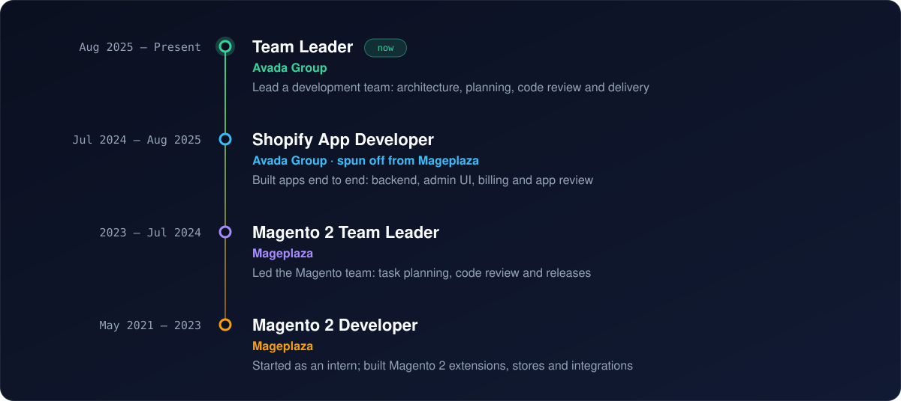
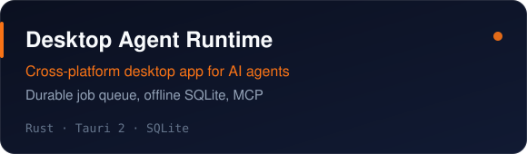

  

  
  

 

## About

I am a full-stack engineer and team leader with 5+ years in e-commerce, from Magento 2 to app development. I design, build, ship and operate products end to end — backend, web, desktop and mobile — and I keep them running in production.

Most of my recent work is in **Go** and **TypeScript**: APIs and background workers on Postgres, React front ends, a **Rust/Tauri** desktop app, and native mobile apps in **SwiftUI** and **Jetpack Compose**. I also built an **AI operations platform** where 70+ specialised agents handle support, QA, code review, security scans and releases, with a person approving only the decisions that matter.

What I care about: typed APIs, honest migrations, CI that blocks bad merges, observability, backups and rollbacks.

 

## Experience

  

 

## Projects

<table>
  <tr>
    <td width="50%"></td>
    <td width="50%"></td>
  </tr>
  <tr>
    <td width="50%"></td>
    <td width="50%"></td>
  </tr>
  <tr>
    <td width="50%"></td>
    <td width="50%"></td>
  </tr>
</table>

Source code is private. Happy to walk through the architecture on a call.

 

## Open source

| | Project | Notes |
|---|---|---|
| 📄 | [**pdf-squeeze**](https://github.com/nguyenvanlinh1902/pdf-squeeze) | Chrome extension that compresses PDFs on-device with Ghostscript WASM. Nothing is uploaded. |

 

## Stack

  

**Backend** — Go (chi, pgx), TypeScript on Bun/Node, Postgres, SQLite, REST and GraphQL, OAuth, JWT, 2FA 
**E-commerce** — Magento 2 (custom modules, integrations), app development for commerce platforms 
**Apps** — React web apps, Rust + Tauri 2 desktop, SwiftUI (iOS), Jetpack Compose (Android) 
**AI** — Claude agents, MCP servers, agent evaluation and self-improvement loops 
**Ops** — Docker, VPS deploys with health checks and rollback, self-hosted mail (Postal), CI/CD, Sentry

 

  Reach me at <a href="mailto:linhnguyenvan1902@gmail.com">linhnguyenvan1902@gmail.com</a>

